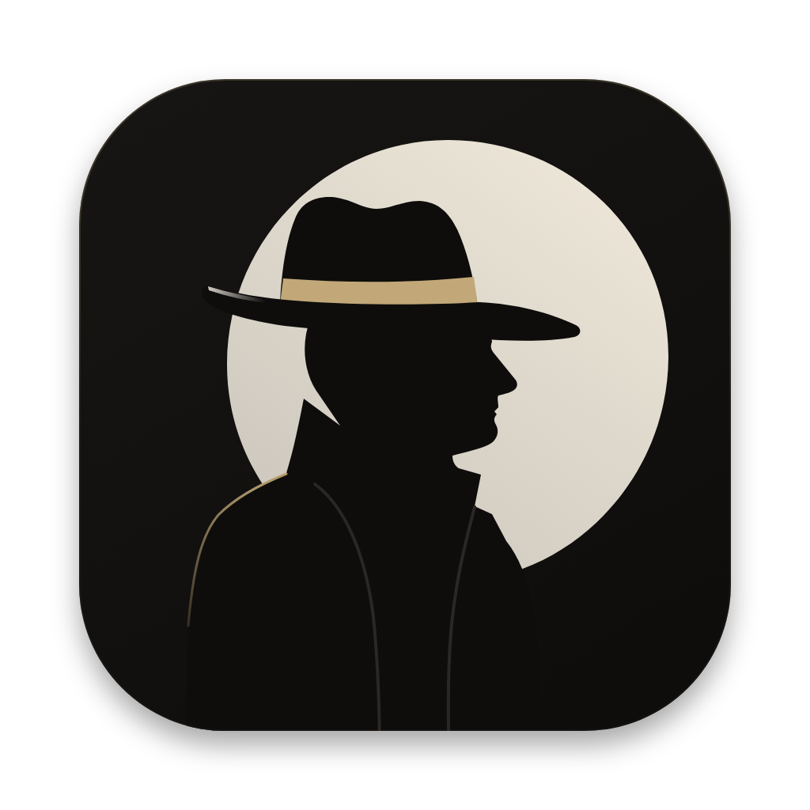

<div align="center">



# counterparty

**see who's on the other side of the trade.**

live order flow for crypto perps, the same data as [aggr.trade](https://aggr.trade), in a native mac app.

<sub>free · macos 14 or later · swift, no dependencies</sub>

</div>

## tl;dr

- **chart**: aggr's chart, candles averaged across every perp of the coin, with volume, delta, cvd and liquidations
- **order book**: the real ladder of one exchange (binance, bybit, okx, deribit), with that market's tape beside it
- **any coin**: ⌘P searches every perp, tabbed like bybit's list, innovation zone included
- **tabs**: open many coins, each keeps streaming in the background so switching is instant
- **(?) mode**: hover anything to learn what the number means, with a good and a bad example
- **trackpad-first chart**: swipe to scroll, pinch to zoom, drag the price axis, tradingview style
- **themes**: 9 built in (atelier, monochrome, tradingview, bybit…) or import your own `.json`
- **works behind dns blocks**: exchanges are looked up over cloudflare's dns-over-https

## build

```sh
./bundle.sh && open Counterparty.app
```
